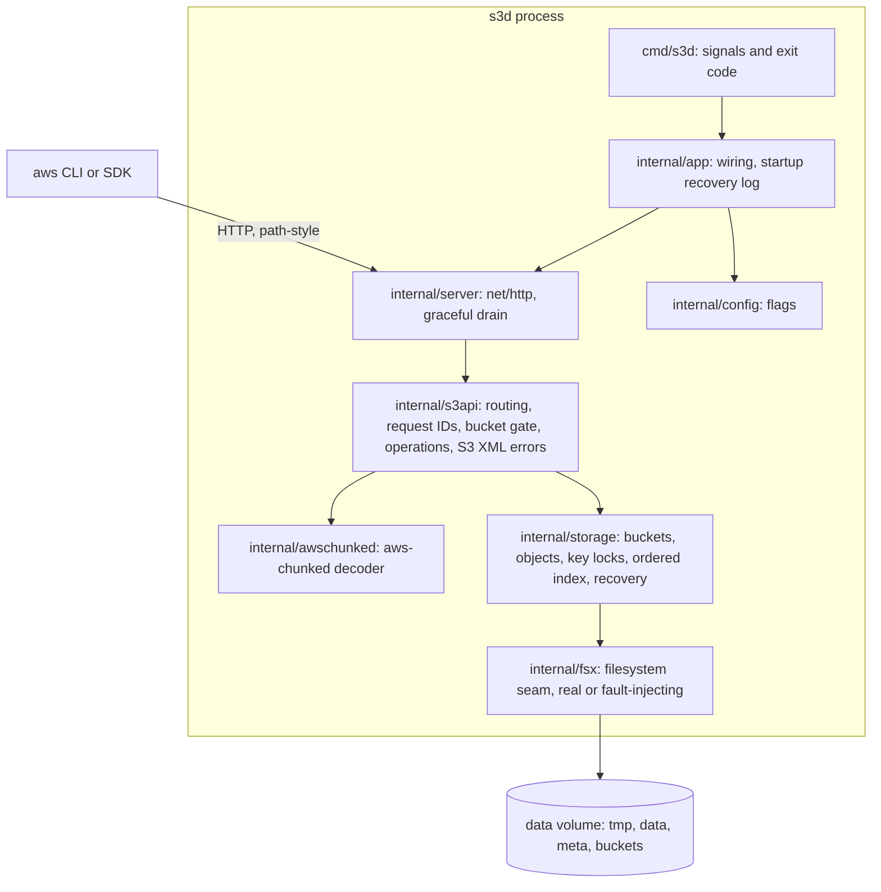
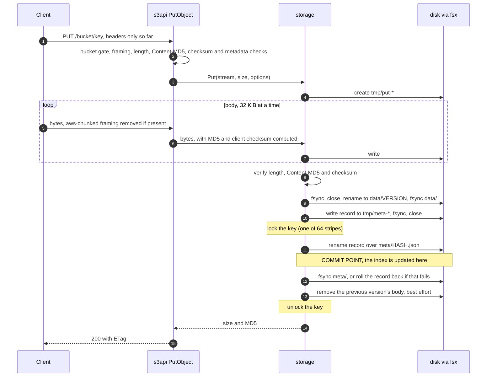

# tiny-s3

[](https://github.com/hermeto/tiny-s3/actions/workflows/ci.yml?query=branch%3Amain)

A minimal S3-compatible object store in Go, with its own storage engine, built to show what it takes for an object
store to never acknowledge data it can lose. It works with the real aws CLI v2 and its default settings.

## What tiny-s3 is

### What was built

- **S3 operations**, path-style, checked end to end with `aws s3api`:
  - buckets: CreateBucket, HeadBucket, ListBuckets;
  - objects: PutObject (Content-MD5, content type, user metadata, aws-chunked bodies with signed or unsigned
    chunks, client checksums CRC32, CRC32C, CRC64NVME, SHA1 and SHA256), GetObject (conditional requests, one
    byte range), HeadObject, DeleteObject;
  - listing: ListObjectsV2 with prefix, delimiter, `max-keys`, continuation tokens, `start-after` and
    `encoding-type=url`.
- **A storage engine that acknowledges a write only once it is durable**: body and metadata are written to temp
  files, fsynced, renamed into place and their directories fsynced; the rename of the metadata record is the
  commit point. Every failure branch is tested through a fault-injecting filesystem layer.
- **Crash recovery**: at startup the server clears interrupted writes, removes bodies no record references,
  rebuilds its in-memory index from the records, and logs what it did. A test kills it with SIGKILL during
  uploads and checks that exactly the acknowledged objects survive, byte for byte.
- **Flat memory**: bodies stream through fixed 32 KiB buffers in both directions; a 2 GiB upload and download keep
  the server's peak RSS below 64 MiB.
- **Production basics**: a distroless, non-root image; graceful shutdown with a bounded drain; JSON logs; S3 XML
  errors with request IDs; CI with race detection, a 100% statement-coverage gate, and an image published to
  GHCR from `main`.
- Standard library only in production code; third-party code only as tools in tests (the aws CLI).

### What was left out, and why

| Left out | Why |
|----------|-----|
| Authentication and SigV4 verification | tiny-s3 targets local development and tests; any credentials are accepted. Verifying signatures adds key management and canonicalization code without changing what the project demonstrates. |
| Multipart upload | Large single PUTs (up to 5 GiB) cover the demo; the design is in [What I would do next](#what-i-would-do-next). |
| Versioning, object lock, ACLs, bucket policies, tagging | Each needs its own metadata model; none is needed to show durable storage. |
| DeleteBucket, CopyObject, ListObjects v1, regions other than us-east-1 | Out of the feature list; they answer `501 NotImplemented` (or `InvalidLocationConstraint` for regions) rather than misbehaving. |
| Multi-node operation and replication | One process owns one data directory. Distribution is a different project. |
| TLS | Terminate it in front (a reverse proxy or load balancer); the e2e tests do exactly that for the aws CLI's HTTPS-only upload framing. |
| Virtual-hosted-style addressing | The aws CLI uses path style for `localhost` and IP endpoints. |
| Prometheus metrics | Accepted technical debt, by the project's constitution; see the next steps. |
| Checksums at rest | Bodies are complete by construction; bit rot is not detected yet (next steps). |

## Run it (Docker only)

You need Docker with Compose v2. The server never runs outside Docker; the build, tests and CI run in pinned
containers too, so Go is not needed on the host.

```sh
git clone https://github.com/hermeto/tiny-s3.git
cd tiny-s3
docker compose up -d --build     # server on localhost:9000, data in the tiny-s3_data volume
docker compose logs s3d          # a "recovery" line, then "listening"
```

`docker compose stop` stops it gracefully (exit code 0); `docker compose down -v` also removes the container and
the data volume. The Compose file runs the image built from this repository's `Dockerfile`; on `main`, CI also
publishes it as `ghcr.io/hermeto/tiny-s3`.

### s3d reference

```text
s3d [-listen ADDR] [-data-dir PATH]
```

| Flag | Default | Meaning |
|------|---------|---------|
| `-listen` | `:9000` | TCP address to listen on (`host:port`; empty host = all interfaces). |
| `-data-dir` | `/data` | Directory for object data. Created if missing (mode 0750); must be writable. |
| `-h` | | Print usage and exit 0. |

| Exit code | Meaning |
|-----------|---------|
| 0 | Stopped by SIGTERM/SIGINT after every in-flight request finished, or `-h`. |
| 1 | Data directory unusable, cannot listen, server error, or shutdown forced at the deadline. |
| 2 | Usage error (unknown flag, empty value, positional argument). |

On the first SIGTERM or SIGINT, s3d stops accepting connections, closes idle ones, and waits up to 9 seconds
for in-flight requests before closing the rest. It always exits within 10 seconds. Later signals are ignored
while it drains. Logs are JSON lines on stdout (`recovery`, `listening`, `shutdown_started`, `shutdown_complete`,
`shutdown_forced`, `handler_panic`, `storage_error`); startup errors are one plain line on stderr (`s3d: <reason>`).
Every start logs `recovery` before `listening`, with the temp files and unreferenced bodies it removed and the
objects, skipped records and buckets it loaded:

```json
{"level":"INFO","msg":"recovery","tmp_removed":0,"orphans_removed":0,"objects_indexed":1,"records_skipped":0,"buckets":1}
```

## Use it with the aws CLI

With the server from the previous section running, paste these commands from the repository directory (any POSIX
shell; tested with zsh and bash). Any credentials work, because requests are not authenticated; the region must be
`us-east-1`. Files are created in a temporary directory that the last lines remove.

```sh
export AWS_ACCESS_KEY_ID=test AWS_SECRET_ACCESS_KEY=test AWS_DEFAULT_REGION=us-east-1 AWS_DEFAULT_OUTPUT=json AWS_PAGER=""
s3() { aws --endpoint-url http://localhost:9000 s3api "$@"; }
repo=$PWD; work=$(mktemp -d); cd "$work"
printf 'hello world' > hello.txt

s3 create-bucket --bucket demo                                                     # 1
s3 head-bucket --bucket demo                                                       # 2
s3 put-object --bucket demo --key docs/hello.txt --body hello.txt \
  --content-type text/plain --metadata owner=alice                                 # 3
s3 head-object --bucket demo --key docs/hello.txt \
  --query '[ContentLength, ContentType, ETag, Metadata.owner]'                     # 4
s3 get-object --bucket demo --key docs/hello.txt copy.txt >/dev/null && cmp hello.txt copy.txt && echo identical   # 5
s3 get-object --bucket demo --key docs/hello.txt --range bytes=0-4 part.txt >/dev/null && cat part.txt && echo     # 6
s3 put-object --bucket demo --key docs/notes/todo.txt --body hello.txt >/dev/null
s3 list-objects-v2 --bucket demo --prefix docs/ --delimiter / \
  --query '{files: Contents[].Key, folders: CommonPrefixes[].Prefix}'              # 7
aws --endpoint-url http://localhost:9000 s3 ls s3://demo/docs/                     # 8
s3 delete-object --bucket demo --key docs/hello.txt                                # 9
s3 head-object --bucket demo --key docs/hello.txt                                  # 10
s3 list-buckets --query 'Buckets[].Name'                                           # 11

cd "$repo"; rm -rf "$work"
docker compose down -v                                                             # 12
```

What you should see (the CLI prints JSON over several lines; the content is):

1. `{"Location": "/demo"}`
2. `{"BucketRegion": "us-east-1"}`
3. `{"ETag": "\"5eb63bbbe01eeed093cb22bb8f5acdc3\""}`: the MD5 of `hello world`, returned once the object is durable.
4. `[11, "text/plain", "\"5eb63bbbe01eeed093cb22bb8f5acdc3\"", "alice"]`
5. `identical`
6. `hello`: the first five bytes.
7. `{"files": ["docs/hello.txt"], "folders": ["docs/notes/"]}`
8. `PRE notes/` and a line for `hello.txt` (11 bytes).
9. No output: the delete succeeded (it succeeds again if repeated).
10. `An error occurred (404) when calling the HeadObject operation: Not Found`
11. `["demo"]`
12. The container and the `tiny-s3_data` volume are removed.

To see every operation exercised automatically, including a SIGKILL during uploads, run `make e2e` (Docker, make
and Bash; about 4 minutes; it uses its own containers and volume and removes them). For a live walkthrough,
`bash scripts/demo.sh` narrates ten steps and pauses before each (`DEMO_PAUSE=0` runs it straight through).

## Design

### Components



`cmd/s3d` only turns signals into a context and returns the exit code; everything else is in `internal/`, where the
coverage gate applies. Every file operation of the engine goes through `internal/fsx`, so tests can fail any one of
them (`fsx.Faulty`) instead of mocking call sites.

### Write path and commit point



An object exists if and only if its metadata record exists in `meta/`. Before the rename of the record (step 11) a
crash leaves only temp files or an unreferenced body, which startup removes; after it the object is complete,
because its body was renamed into `data/` and fsynced first. The answer is sent only after `meta/` is fsynced
(step 12), so an acknowledged write survives a crash. If that fsync fails, the engine puts the previous record
back (or removes the new one) before answering with an error, so a failed write never leaves the new version
visible. Every request header is checked before the first body byte is read, so an `Expect: 100-continue`
client never uploads a body that will be rejected.

### On-disk layout

```text
/data/                     the -data-dir, a named Docker volume
├── tmp/                   files of in-flight writes; emptied at every start
├── data/<version>         one immutable body per committed write; <version> is random
├── meta/<hash>.json       one record per object: the commit point
│                          <hash> = hex SHA-256 of len(bucket) ":" bucket key
└── buckets/<name>.json    one record per bucket
```

A record holds the bucket, key, size, MD5, last-modified time, content type, user metadata and the name of its
body file. Hashed record names mean no key, however strange (`..`, `/`, Unicode), can address a path outside the
store. Bodies are never overwritten: an overwrite writes a new body, commits a record that points at it, then
removes the old body.

### Index

Listing is served from an in-memory index: per bucket, a sorted slice of keys with their size, MD5 and
last-modified time. It is rebuilt from `meta/` at startup and changed, under the key lock, at the exact moment a
record file is renamed in, rolled back or removed, so a listing always agrees with `HeadObject`. Page starts and
the jump past a common prefix are binary searches, and a listing reads no file. Continuation tokens encode a
position (the last key, or the last common prefix), not server state: every key that exists for the whole listing
is returned exactly once under concurrent writes, and tokens stay valid across restarts. Inserting a new key
shifts the slice, which is cheap up to about a million keys per bucket; a B-tree is a next step.

### Concurrency

- **Writers to one key**: commits, deletes and the record lookup of a read hold the key's lock (64 striped
  mutexes, so memory does not grow with the number of keys). Uploads stream outside the lock; only the commit is
  serialized, so concurrent PUTs to one key end with exactly one complete winner and no leftover body.
- **Readers**: a GET opens the body file under the key lock, then streams it without the lock. Bodies are
  immutable and POSIX keeps an unlinked open file readable, so a download that started finishes with the version
  it opened, whatever overwrites and deletes happen meanwhile.
- **Index and buckets**: each has a read-write mutex; listings take the read side.
- **One process per data directory**: the locks are in-process. A second s3d on the same volume is unsupported
  (see the failure modes).

### Recovery

Startup is a recovery pass, done before the port opens: create the layout; remove everything in `tmp/`; load the
bucket records (a bad one stops startup with its path); list `data/`; read every record, indexing those that
decode, sit under the right name and have their body, and counting the rest as skipped; remove every body no
indexed record names. The removals are idempotent, so they need no fsync: a crash that undoes one only repeats it
next time. s3d then logs one `recovery` line with the counts and starts listening.

### Request handling

A hand-written router maps method, path and subresources to an operation without cleaning paths (so `a//b` and
`dir/../x` stay distinct keys) and answers unimplemented S3 operations with `501 NotImplemented`. Every response
carries a request ID. A bucket gate answers `NoSuchBucket` or `InvalidBucketName` for every operation on a bucket
except CreateBucket. Errors are S3 XML documents; a failure after a response has started aborts the connection,
so a client never sees a short success.

### Trade-offs, feature by feature

Each feature records the trade-offs it made, as the constitution requires. Expand a feature to read them.

<details>
<summary><strong>001 server skeleton</strong></summary>

- **Distroless `nonroot` runtime, digest-pinned images.** The binary is static, so the runtime image has no
  shell or package manager and runs as UID 65532. Both images are pinned by tag and digest for reproducible
  builds; updating them is a deliberate change. The image ships an empty `/data` owned by 65532, and Docker
  copies that ownership into an empty named volume, so no chown step or root entrypoint is needed.
- **9-second drain inside a 10-second budget.** The drain deadline leaves 1 second for closing connections and
  exiting. Docker's default stop grace period is also 10 seconds and would race that, so `compose.yaml` sets
  `stop_grace_period: 15s`. s3d is PID 1 (exec-form entrypoint, no init) and handles signals itself; it spawns
  no children, so nothing needs reaping.
- **Request contexts are not tied to the shutdown signal**, so in-flight requests finish instead of being
  cancelled when SIGTERM arrives.
- **No `ReadTimeout`/`WriteTimeout`.** Object bodies will be streamed, and a global deadline would cut off large
  transfers. Only `ReadHeaderTimeout` (10 s) is set, against slow-header clients; per-request deadlines come with
  the streaming operations.
- **No health-check route.** In path-style S3 any path can be a bucket name, so a reserved path would collide
  with S3 semantics. Readiness is a TCP connect to the port.
- **Placeholder 501 `NotImplemented` for every request**, in the S3 XML error format with a request ID in the
  body and in `x-amz-request-id`. Each S3 feature replaces it route by route.
- **Flags only, no environment variables.** One source of truth; `compose.yaml` sets both flags explicitly.
- **`internal/fsx` from the start.** The constitution requires I/O failures to be tested through a
  fault-injection layer. Permission-bit tests would not work anyway, because the dev container runs as root and
  root ignores them. The data directory check is `MkdirAll` plus a create/close/remove probe; `MkdirAll` already
  rejects a path that is a regular file, so there is no separate `Stat`.
- **Coverage gate counts statements, not percentages.** `scripts/cover-gate.sh` sums covered and total
  statements per package from the profile and fails on any difference, so 2499/2500 fails even though it prints
  as 100.0%. Packages without tests are found with `go list`, because since Go 1.22 they still appear in the
  profile with zero hits.
- **e2e tests hold requests open from the client side.** The placeholder handler answers at once, so the e2e
  test sends a complete header and half of a small declared body. Before flushing the response, `net/http`
  drains the unread body (under 256 KiB), which keeps the connection active until the client sends the rest:
  sending it tests the clean drain, withholding it tests the forced 9-second path. A request whose header is
  still incomplete is never treated as in flight: `net/http` closes such a connection as idle once it is 5
  seconds old, and drops a header completed after shutdown began.

</details>

<details>
<summary><strong>002 CI pipeline</strong></summary>

- **Gates call `make`, not `actions/setup-go`.** CI runs the same Makefile targets in the same digest-pinned
  container as developers, so there is one toolchain definition and CI cannot drift from local. The cost is
  pulling the golang image in every gate job.
- **Caches through overridable bind mounts.** Runners start with empty Docker volumes, so `GOMOD_CACHE` and
  `GOBUILD_CACHE` let CI mount runner directories that `actions/cache` saves and restores. They default to the
  named volumes, so local runs are unchanged. The names avoid Go's `GOMODCACHE`/`GOCACHE` because make imports
  the environment, and a host Go setup must not leak into the container.
- **Caches are saved only from `main`.** Every run restores; only successful pushes to `main` save, for the Go
  caches and the image layer cache. A branch can never seed a cache that `main` reads, and the 10 GB cache quota
  is not churned by short-lived branches. A branch's second push is therefore no faster than its first until
  `main` has a cache.
- **Push and pull request triggers both run.** A pull request branch is validated twice per commit, once per
  event. Accepted for simplicity; runner minutes are free for public repositories.
- **`main` runs are serialized, never cancelled.** They finish in push order, so `latest` never moves back to an
  older commit. GitHub keeps only the newest queued run, so when several commits land during a run, the
  intermediate ones get no SHA tag. A manual re-run of an older `main` run is the one case ordering does not
  cover, so `publish` tags `latest` only when the run's commit is still the tip of `main`; the SHA tag is always
  pushed.
- **Publish rebuilds from the layer cache** instead of passing the `docker build` image as an artifact. With a
  warm cache the layers are the ones the check built, without an upload/download round trip. Revisit if spec
  014 needs to run e2e against the exact built image. Provenance metadata includes build timestamps, so a re-run
  can push a new digest with the same layers.
- **Actions pinned by commit SHA, kept current by Dependabot.** Tags can be moved by whoever controls the action
  repository; SHAs cannot. Dependabot opens weekly pull requests that bump the SHA and its version comment.
- **Least privilege.** The workflow token is read-only; only `publish` gets `packages: write`. Checkout runs with
  `persist-credentials: false`, so no make target or build step can read the token from `.git/config`.
  `pull_request_target` is not used, so fork pull requests never run with write access.
- **Anonymous Docker Hub pulls.** No Docker Hub secret is stored. If pull limits start failing runs, add a
  read-only Docker Hub token as a secret and a login step in the gate and image jobs.

</details>

<details>
<summary><strong>003 S3 routing and errors</strong></summary>

- **Own router, not `http.ServeMux`.** `ServeMux` cleans paths and redirects, which would turn keys such as
  `a//b`, `./a` or `dir/../x` into other keys, and its patterns cannot match query parameters or headers. The
  router is one `switch` over method, path shape, subresources and `x-amz-copy-source`; the full table is in
  `specs/003-s3-routing-errors/contracts/http.md`.
- **Keys are decoded once, by `net/http`.** Bucket and key come from `r.URL.Path` as is; nothing in the router
  decodes again. `+` stays `+`, and `a%2Fb` is the same key as `a/b`, as in S3. A request target with invalid
  percent-encoding never reaches the router: `net/http` answers a plain-text `400` without a request ID. Making
  it an S3 error would need our own HTTP parser, for a request no real client sends.
- **501 versus 405.** A real S3 operation the server does not have (a subresource such as `?acl`, ListObjects
  v1, DeleteBucket, any `POST`, CopyObject) gets `501 NotImplemented`; a method S3 does not support, or one with
  no meaning on `/`, gets `405 MethodNotAllowed`. A subresource wins over everything, so `GET /b?list-type=2&acl`
  is `501`. CopyObject is detected by its header so it can never run as a PutObject with an empty body.
- **Fixed subresource list, other parameters ignored.** Routing looks only for the S3 subresource keys
  (case-sensitive, on presence). Unknown parameters are ignored, as S3 does, so SDK additions such as `x-id`
  and presign parameters never block a request. `versionId` and `partNumber` count as subresources: versioning
  and part reads are out of scope.
- **Path-style only.** Virtual-hosted-style requests are routed on their path and so reach the wrong bucket;
  clients must use path-style addressing, which the aws CLI does for `localhost` and IP endpoints.
- **One request ID per request, set before routing.** Every response carries `x-amz-request-id`, including
  successes; `WriteError` reuses it, so the header and `RequestId` always match.
- **Panics become `500 InternalError`.** A panicking operation is logged as `handler_panic` with its request ID.
  If the response has already started, the connection is aborted instead, so the client sees a failed transfer
  rather than a truncated success. The writer wrapper that tracks this implements `Unwrap`, so
  `http.ResponseController` still works for streaming handlers; it does not forward `io.ReaderFrom`, which
  GetObject can add if sendfile matters.

</details>

<details>
<summary><strong>004 filesystem failure injection</strong></summary>

- **One explicit `internal/fsx` seam.** The real `fsx.OS` adapter delegates directly to the operating system,
  while tests wrap it with `fsx.Faulty`. This keeps production behavior unchanged and prevents call-site mocks
  from hiding a filesystem operation that the storage engine performs.
- **Glob paths and Nth matching calls.** Fault rules match an operation plus a `path.Match` pattern and count
  only matching calls. The rule fires on its configured Nth match; this is more precise than a global call index
  when temporary files and unrelated directories are involved.
- **History records attempted calls, including failures.** The fake records operation, paths, byte counts and
  final error in a copy-safe ordered snapshot. Recording failed attempts makes durability-order assertions
  useful when the failure itself is the behavior under test.
- **Short writes are surfaced, not retried by the fake.** A configured write can return fewer bytes and a nil
  error is normalized to `io.ErrShortWrite`. Retry policy belongs to the storage caller, so the fake does not
  silently turn an incomplete write into success.
- **The object storage write path is not in this repository yet.** This feature provides and tests the complete
  seam, including the write/sync/rename/directory-sync sequence, so the future storage path can consume it
  without another abstraction or mock layer.

</details>

<details>
<summary><strong>005 durable object storage</strong></summary>

- **The metadata record is the commit point.** Put streams the body into `tmp/`, syncs it, renames it to an
  immutable `data/<version>` file and syncs `data/`; only then does it write the record to `tmp/`, sync it,
  rename it over `meta/<hash>.json` and sync `meta/`. A crash before the record rename leaves the old state;
  the cost is two file syncs and two directory syncs per Put.
- **Immutable data versions instead of overwrite in place.** Every Put writes a new data file and the record
  points at it, so a reader that opened a version keeps reading it after an overwrite or delete (POSIX keeps
  unlinked open files alive). The previous version is removed only after the new record is durable.
- **Hashed record names.** `meta/` holds `hex(sha256(len(bucket) ":" bucket key))`. No key can name a path
  outside the store, and the length prefix keeps the mapping unambiguous without relying on bucket-name
  rules. The record stores the real bucket and key, which a future index rebuild will read back.
- **Striped key locks, single process.** 64 mutexes serialize commit, Delete, Head and Get's record-plus-data
  lookup per key, so concurrent Puts end with exactly one winner and no orphaned loser data. Uploads stream outside
  the lock. The locks are in-process, which is enough because one s3d owns a data directory.
- **Rollback when the `meta/` sync fails after the rename.** The engine restores the previous record (or
  removes the new one) so a failed Put never leaves the new version visible. If the rollback also fails, the
  error is returned and the new data is kept, so the key points at a complete version, never a partial one.
- **Best-effort cleanup after the commit.** Removing the previous version's data after a commit, or the data
  file after a Delete, does not fail the operation; a failure leaves an invisible orphan. `Open` clears
  `tmp/`, but orphans in `data/` (also from a crash between the data rename and the record commit) wait for
  the index-rebuild feature, which has to read every record anyway.
- **Flat directories.** `data/` and `meta/` have no hash fan-out. ext4 and XFS index large directories, and
  the record format names its data file, so fan-out can come later without a migration.
- **Not wired to HTTP in this feature.** The engine had no S3 object endpoint here; the PutObject feature maps its
  errors (IncompleteBody, BadDigest, EntityTooLarge, KeyTooLongError, NoSuchKey) to S3 responses and adds the
  `aws s3api` e2e tests.

</details>

<details>
<summary><strong>006 minimal bucket support</strong></summary>

- **Buckets are durable records plus an in-memory map.** Each bucket is `buckets/<name>.json` (`v`, `name`,
  `created`) in the store root, written like an object record: temp file in `tmp/`, sync, rename, sync
  `buckets/`. The rename plus sync is the commit point, and a sync failure after the rename removes the record
  again (if that also fails, the complete record is kept and the bucket exists). `storage.Open` loads every
  record into a map, so the bucket check on every request is a map lookup, and the store is opened before the
  port: a listening server has every bucket loaded.
- **Readable file names, not hashes.** Bucket names are validated before they become file names, and a valid name
  is `[a-z0-9.-]` without `..`, so it cannot leave `buckets/`. Operators can see the buckets with `ls`.
- **Fail to start on a bad bucket record.** A record that does not decode, has an unknown version, a name that
  differs from its file name, or no creation date stops `s3d` with the path in the error. The write path never
  leaves a partial record, so a bad one means outside interference; hiding the bucket would make its objects
  unreachable without a trace.
- **One lock for all creates.** CreateBucket holds one write lock across its whole write path, so concurrent
  creates of a name have exactly one winner; checks and lists share a read lock. Creates are rare, so
  serializing them costs nothing.
- **One gate for every bucket and object operation.** `Ops.CheckBucket` runs after routing and before the
  operation (and before the NotImplemented fallback), for every request on a bucket except CreateBucket. So
  object operations already answer `NoSuchBucket` on a missing bucket, and the object features inherit the check.
  Requests rejected by routing (subresource, method, invalid URI) keep their errors. The storage engine's object
  calls do not check the bucket themselves: one process owns the store and buckets cannot be deleted yet, so
  the HTTP gate is enough. DeleteBucket will have to revisit this.
- **Name validation on every bucket request.** The current S3 rules for general purpose buckets, including the
  IPv4 form and the reserved prefixes and suffixes, apply to create, check and the object operations, so an
  invalid name answers `400 InvalidBucketName`, never `404`. Legacy us-east-1 names (uppercase, underscores) are
  rejected.
- **409 on re-create, unlike real us-east-1.** S3 in us-east-1 answers `200` when you re-create a bucket you own;
  every other region answers `409 BucketAlreadyOwnedByYou`. tiny-s3 answers 409, which is what clients handle
  everywhere and what tells a script it did not create the bucket.
- **us-east-1 only, checked on create.** A create body naming another region answers `400
  InvalidLocationConstraint` instead of silently creating the bucket here; no body, no location, an empty location
  or `us-east-1` are accepted (S3 itself rejects an explicit `us-east-1`; accepting it is harmless). A body over
  64 KiB or that is not a `CreateBucketConfiguration` answers `400 MalformedXML`. Object Lock and ACL headers on
  create are ignored.
- **ListBuckets in one page.** All buckets, sorted by name, with a fixed owner (`tiny-s3`); `prefix`,
  `max-buckets` and `continuation-token` are ignored. Fine at S3's default quota of 10,000 buckets; paging can be
  added without changing the store.
- **Real aws CLI in `make e2e`.** The e2e image is the official `amazon/aws-cli` image pinned by digest, with the
  Go tree copied from the same pinned golang image as every other target, so there is still one toolchain
  definition. CI runs `make e2e` since feature 014.

</details>

<details>
<summary><strong>007 PutObject</strong></summary>

- **Every header check before the first body read.** Bucket gate, aws-chunked, length, `Content-MD5` format and
  metadata size are checked, and the engine validates key length and object size, before the body is touched. A
  client sending `Expect: 100-continue` (the aws CLI does) therefore never uploads a body that will be rejected.
- **Content type and user metadata in the existing record.** The record keeps format version 1 and gains two
  optional fields; older records read as `binary/octet-stream` with no metadata, so no migration. Metadata names
  are lowercased, repeated headers are joined with `,`, and names plus values are limited to 2 KB, as in S3.
  Other standard headers (Cache-Control, Content-Disposition, Expires) are not stored.
- **Early disconnect is `IncompleteBody`.** net/http reports a body shorter than its `Content-Length` as
  `io.ErrUnexpectedEOF`; the engine maps it to `IncompleteBody`, and the S3 layer maps a cancelled request context
  the same way. Both fail before the commit, so nothing is stored and the temp file is removed. The client is
  usually gone and never sees the 400; the status matters for logs and half-closed connections.
- **aws-chunked was refused, not stored** (replaced by decoding in 008). Until feature 008, a `Content-Encoding: aws-chunked` or
  `STREAMING-*` upload answers `501 NotImplemented`, because storing the chunk framing would corrupt the object.
  Over plain HTTP the aws CLI 2.31 sends ordinary bodies (checked with a capture), so the default CLI works.
- **Checksum and signature headers were ignored here.** The CLI sends `x-amz-checksum-crc64nvme` and a hex
  `X-Amz-Content-SHA256`; feature 008 verifies the checksums. SigV4 is out of scope.
- **One mapping from engine errors to S3 errors.** Bucket and object operations share it; errors with no S3
  meaning answer `500 InternalError` and are logged as `storage_error` with the request ID, bucket and key (006's
  `bucket_error` log was renamed).
- **Flat memory proven at 2 GiB on the real binary.** An e2e test streams a generated 2 GiB body and checks the
  server's peak RSS (`VmHWM`) stays below 64 MiB, on top of the engine's 64 MiB allocation test.

</details>

<details>
<summary><strong>008 aws-chunked decoding</strong></summary>

- **The CLI frames uploads only over HTTPS.** Captures of aws CLI 2.31.11 show plain bodies with an
  `x-amz-checksum-crc64nvme` header over HTTP, and `Transfer-Encoding: chunked` plus `Content-Encoding:
  aws-chunked` with a CRC64NVME trailer over HTTPS. tiny-s3 serves plain HTTP, so the e2e tests put a TLS reverse
  proxy in front of s3d, run the real CLI against it with its default settings, and assert that the proxy saw
  aws-chunked bodies; otherwise a passing test would prove nothing about the decoder.
- **A small decoder package.** `internal/awschunked` reads through one 4 KiB `bufio.Reader`: chunk data passes
  straight through, and chunk-header and trailer lines longer than 4 KiB are rejected, so memory does not depend on
  chunk or object size (a 64 MiB single-chunk test allocates under 4 MiB). It accepts signed and unsigned framing
  and ignores chunk and trailer signatures (SigV4 is out of scope). A stream cut short is `IncompleteBody`; one that
  breaks the framing, or has bytes after its end, is `InvalidRequest`.
- **The declared decoded length is the object size.** `X-Amz-Decoded-Content-Length` replaces `Content-Length` for
  framed uploads (411 when absent); the engine's exact-length copy turns any disagreement into `IncompleteBody`.
- **Checksums are verified before the commit, then dropped.** CRC32, CRC32C, CRC64NVME (`hash/crc64` with the NVMe
  polynomial), SHA1 and SHA256, from one header or from the trailer named in `x-amz-trailer`. The body is teed into
  the hash, and a `Verify` callback in `storage.PutOptions` runs after the last byte and before the sync, so a
  mismatch (`BadDigest`) never reaches the commit point. Two checksums or an invalid value are `InvalidRequest`.
  Checksums are not stored or echoed, so GetObject cannot return them.
- **Content-Encoding is not stored.** An `aws-chunked,gzip` upload stores the gzip payload, and reading it back will
  not say it is gzip. Storing Content-Encoding would come with the other standard headers.
- **Unsigned hex `X-Amz-Content-SHA256` is not checked.** It is part of SigV4, which stays out of scope.

</details>

<details>
<summary><strong>009 GetObject and HeadObject</strong></summary>

- **Reads come from the engine's immutable versions.** `Get` opens the data file under the key lock (005), so a
  download that started keeps its version through overwrites and deletes; tests prove it at the handler level
  (engine overwrite and delete) and end to end (HTTP overwrite while a download is half read).
- **A failure after the status aborts the connection.** Once `200` and `Content-Length` are sent, a read error or a
  client write error ends with `http.ErrAbortHandler`, so the client sees a broken transfer, never a short success.
  Read errors are logged as `storage_error`; a client that leaves is not an error.
- **One 32 KiB copy buffer per download.** The reader is wrapped so `io.CopyBuffer` uses it rather than the file's
  `WriteTo`; the 2 GiB e2e test also downloads the object and keeps peak RSS below 64 MiB. This gives up sendfile;
  it can come back by forwarding `io.ReaderFrom` through the handler's response writer.
- **User metadata names go out in lowercase.** `Header.Set` would canonicalize `x-amz-meta-owner` to
  `X-Amz-Meta-Owner`, and clients keep the case they receive as the metadata key; S3 sends lowercase, so the
  headers are written without canonicalization (found by the aws CLI e2e test).
- **Conditional requests in the HTTP order S3 follows.** `If-Match`, else `If-Unmodified-Since` (412); then
  `If-None-Match`, else `If-Modified-Since` (304), so S3's documented special cases fall out of the order. Dates
  compare in whole seconds, the precision of `Last-Modified`; unparseable dates are ignored; ETag lists, `*`, weak
  and unquoted ETags are accepted. A missing key is 404 whatever the conditions. Not `http.ServeContent`: its
  errors are not S3 XML and its range rules differ from S3's (feature 010).
- **Not supported**: `response-*` query overrides, checksum headers (not stored, 008), versions.

</details>

<details>
<summary><strong>010 range requests</strong></summary>

- **S3's single-range rules, not `http.ServeContent`.** One range (`first-last`, `first-`, `-suffix`) answers 206
  with `Content-Range`; an end past the object is clamped and a suffix longer than the object returns it all. A
  start at or past the end, `bytes=-0`, or any range on an empty object is `416 InvalidRange` with
  `Content-Range: bytes */size`. Multiple ranges and malformed headers return the whole object with 200, because
  S3 does; `ServeContent` would answer multipart/byteranges.
- **Order.** Key lookup (404), then the 009 conditions (412/304), then `If-Range`, then `Range`. A non-matching
  `If-Range` (other or weak ETag, other date, garbage) returns the whole object, even when the range would be
  unsatisfiable.
- **HEAD honors `Range`** with the same status and headers as GET, as S3 does.
- **Same streaming path as full downloads.** An `io.SectionReader` over the engine's reader goes through the fixed
  32 KiB buffer and the abort-after-status rule; the 2 GiB e2e test also fetches its second half as a range with
  peak RSS below 64 MiB.
- **The 416 body is the standard error body**, without S3's extra `RangeRequested` and `ActualObjectSize`
  elements; clients read the code and `Content-Range`.

</details>

<details>
<summary><strong>011 DeleteObject</strong></summary>

- **A thin wrapper over the engine's delete.** The 005 engine removes the record (the commit point) and syncs
  `meta/` before returning, so the 204 means the removal is on disk; an e2e test sends SIGKILL right after the
  CLI's delete returns and the key stays gone after the restart. SIGKILL keeps the page cache, so this proves the
  acknowledged state reached the filesystem; the engine's operation-order tests cover the fsyncs.
- **Two failure points, two outcomes.** A failed record removal answers 500 and the object stays readable. A
  failed `meta/` sync after the removal answers 500 and keeps the body, so the object is gone or, if the record
  reappears after a crash, complete. Promising "still readable" in that case is impossible once the record is
  removed; the first draft of this spec did, and the test caught it.
- **Idempotent, unconditional, unversioned.** 204 whether or not the key existed (a corrupt record is removed),
  conditional headers ignored, no delete markers. Multi-object delete stays 501.
- **Open downloads finish.** Unlinking the data file does not affect a reader that opened it; the e2e test now
  overwrites and deletes a key while a download of it is half read.

</details>

<details>
<summary><strong>012 ordered index and ListObjectsV2</strong></summary>

- **A sorted slice per bucket, in memory.** Keys are kept in UTF-8 byte order with their size, MD5 and
  last-modified; page starts and group jumps are binary searches, and a listing reads no file (a test checks the
  filesystem history stays empty). Inserting a new key shifts the slice: microseconds at 10k keys, about a
  millisecond at 1M keys per bucket. A B-tree would remove that limit; it is a next step, not needed at this
  scale. A 1,000-key page from 10,000 keys is checked to answer within 100 ms (`make test`; not under `-race`).
- **The index mirrors the record files, under the key lock.** It changes exactly when a record is renamed in,
  rolled back or removed (even if the following directory sync fails), so a listing never shows a key `Head` would
  not find, or misses one it would. Every failure path of Put and Delete is tested against that rule.
- **Rebuilt from `meta/` at startup**, as the constitution says. A record that does not decode, or sits under a
  file name that is not its key's hash, is left out instead of stopping the server: reading it still answers 500
  and writing or deleting it repairs it. I/O errors still fail startup. Crash cleanup and startup counts are 013.
- **Tokens encode a position, not server state.** A continuation token is base64url of `k`+last key or
  `g`+last common prefix; the next page starts strictly after that key, or after every key of that group. So
  every key that exists for the whole listing is returned exactly once under concurrent writes (tested in
  process under `-race` and through the CLI with 2,500 keys), and tokens survive restarts. A token wins over
  `start-after`, which is still echoed.
- **URL encoding that both decoders accept.** With `encoding-type=url` (the CLI's default), every byte except
  unreserved characters and `/` becomes `%XX`, so a space is `%20` and `+` is `%2B`: correct whether the client
  decodes with `unquote` or `unquote_plus` (the packaged botocore could not be inspected; the e2e test lists keys
  with spaces, `+`, `%`, tabs and UTF-8 through the CLI).
- **S3 details kept**: `max-keys` defaults to and caps at 1000, `max-keys=0` is an empty complete page,
  `KeyCount` counts keys plus common prefixes, `StorageClass` is `STANDARD`, no owner. The CLI's paginator drops
  per-page fields such as `KeyCount`; tests read them with `--no-paginate`.
- **Not supported**: ListObjects v1 (501), `fetch-owner`, keys with characters XML 1.0 cannot carry unless
  `encoding-type=url` is used.

</details>

<details>
<summary><strong>013 crash recovery and concurrency</strong></summary>

- **Startup is a recovery pass.** `storage.Open` empties `tmp/`, loads the buckets, lists `data/`, indexes every
  valid record whose body exists, and removes every body no indexed record names, then reports the counts that
  `s3d` logs as `recovery`. The write order of 005 means a crash can only leave temp files, bodies without a
  record (between the body and record renames) and replaced versions not yet removed; never a record without its
  body. A record whose body is missing anyway (outside interference) is skipped and counted, not deleted.
- **Cleanup needs no fsync and fails loudly.** Removing a leftover is idempotent, so a crash that undoes it just
  repeats it next time; a removal that fails stops startup with the path, rather than serving with unknown state.
- **Proven with a real SIGKILL mid-upload.** The e2e test starts 20 uploads of 4 MiB, lets 10 finish, polls `tmp/`
  until the other 10 hold temp files (so the kill provably lands mid-body), plants an orphan, kills, restarts and
  checks: the recovery line (10 temp files, 1 orphan, 10 objects), an empty `tmp/`, exactly the 10 acknowledged
  keys listed and downloaded byte for byte, the listing equal to a scan of `meta/`, and 10 bodies in `data/`.
  SIGKILL keeps the page cache, so this proves the on-disk ordering, not power-loss durability; the engine's
  operation-order tests (005) cover the fsyncs.
- **Randomized fault injection.** An engine test runs 200 random puts, overwrites and deletes per seed (20 fixed
  seeds) with a random fault in a third of them; the faults make 18–39 operations fail per seed. Before and after a
  reopen, the index equals an independent scan of the records, and after the reopen `data/` holds exactly the
  referenced bodies. The test fails if the faults stop biting.
- **Contention.** 50 concurrent uploads to one key end with exactly one of the bodies, its ETag, one body file and
  an empty `tmp/` (e2e).
- **Not checked at startup**: body checksums (reading every byte would make startup proportional to the data).
  Bodies are complete by construction: they are renamed into `data/` only after a full, synced write.

</details>

<details>
<summary><strong>014 end-to-end suite and demo</strong></summary>

- **Three layers in one command.** `make e2e` runs the Go tests of the binary (process behavior the image cannot
  show: signals, raw protocol, peak memory), then a container suite against the image built from the
  `Dockerfile` (the shipped artifact), then the demo without pauses so it cannot rot. Each step fails the target.
- **The suite is isolated.** Every run has its own network, volume and containers named `tiny-s3-e2e-<pid>-*`, no
  published port, and a trap that removes them on success, failure, Ctrl-C or SIGTERM. A running Compose stack
  keeps serving during a run (checked). The checks run in a client container (the e2e image) through `docker
  exec`; an inspector container mounts the volume read-only to look at `tmp/` and `data/`.
- **The real CLI with its defaults**, except where a check needs otherwise: 2,500 keys are uploaded with `aws s3
  cp --recursive` for speed (every check uses `aws s3api`), and the crash test's in-flight uploads are throttled.
- **A crash test that cannot pass by luck.** Ten `put-object` uploads finish and are acknowledged; ten more go
  through `aws s3 cp` throttled to 4 MB/s (single part, no retries), so they are mid-body for about 8 s. The host
  kills the server only once all ten fast ones are acknowledged and at least five slow ones hold temp files, then
  requires the restart's `recovery` line to report removed temp files, every acknowledged key listed, every listed
  key equal to its source with a matching ETag, and one body per object. Earlier drafts let the kill land with
  nothing in flight; the test now fails if that happens.
- **Proven to catch breakage.** With the PutObject ETag deliberately broken (not committed), the suite exits 1
  with `FAIL object/put-small` and the expected and actual ETags.
- **`cmp` from the client image's own distribution.** The aws-cli image lacks `cmp`; `e2e/Dockerfile` installs
  `diffutils-3.8-1.amzn2023.0.2`, an exact version from Amazon Linux 2023's release-locked repositories.
- **CI**: a `make e2e` job (30-minute timeout) on every push and pull request; `publish` now waits for it.
  Making it a required check is an admin's ruleset change; the command above includes it.
- **Shell scripts** use `set -euo pipefail`, stay Bash 3.2 compatible on the host side (macOS), and pass
  `make shellcheck`.

</details>

<details>
<summary><strong>015 README and architecture</strong></summary>

- **Eight questions, in the order an evaluator asks them.** What was built and left out, how to run it, how to use
  it, the design, the failure modes, the tests, the next steps and how AI was used. Operational reference (flags,
  exit codes, logs, make targets, CI, ruleset) moved into the section it belongs to rather than being dropped.
- **Trade-off records collapsed, not moved.** The constitution requires them in the README's design section, so
  they stay there, one collapsed block per feature, unchanged in substance.
- **Every failure row has a proof that is checked.** The test names in the failure table were checked against the
  code (each has a `func Test…`), the container-suite checks against `scripts/e2e`, and the rows without a test say
  why in a note: power loss, disk full, two processes on one volume, bit rot.
- **The walkthrough was run as written from a fresh clone**, with the aws CLI on the host, and its expected output
  is what it printed. It works in a temporary directory and ends by removing it and the Compose volume.
- **Attribution limited to what the repository records.** The AI section names the author's decisions (the
  constitution, the feature descriptions and acceptance criteria, the process rules, feature 003's clarifications)
  and what was delegated (clarifications, analysis fixes and design choices of features 005–015, recorded in each
  feature's artifacts).

</details>

## Failure modes

Each row names the tests that prove the handling (Go tests in `internal/` and `e2e/`, or checks of the container
suite in `scripts/e2e/`), or says why there is no test.

| Failure | How it is handled | Proof |
|---------|-------------------|-------|
| I/O error or crash at any step of a write | The temp file is removed, no new version becomes visible, the previous one stays intact; a failed `meta/` fsync after the commit rename rolls the record back | `TestPutFailsCleanlyAtEveryStep` (fails each operation of a real write in turn), `TestPutHistoryFollowsDurabilityOrder`, `TestPutRollbackFailure`, `TestHeadNeverSeesRolledBackCommit` |
| Server killed (SIGKILL) during uploads | At restart: temp files removed, only acknowledged objects listed, each byte-identical to its upload | `TestKillDuringUploads`; container suite `crash/kill`, `crash/recovery`, `crash/acknowledged`, `crash/etags`, `crash/bodies` |
| Crash between a body's rename and its record's commit | The unreferenced body is removed at startup | `TestRecoveryCleansLeftovers`, `TestRecoveryAfterRandomFailures` |
| Crash right after an acknowledged delete | The object stays deleted after restart | `TestDeleteSurvivesKill` |
| Delete that fails halfway | Record removal fails: 500, object still readable. `meta/` fsync fails after the removal: 500, body kept, so a record that reappears after a crash points at a complete body | `TestDeleteObjectStorageFailures`, `TestDeleteFailures` |
| Client disconnects mid-upload, or sends fewer bytes than declared | `IncompleteBody`, nothing stored | `TestPutObjectEarlyDisconnect`, `TestPutUnexpectedEOFIsIncompleteBody`, `TestPutObjectRejectsCLI` |
| Corrupted upload (wrong Content-MD5 or client checksum) | `BadDigest` before the commit, nothing stored | `TestPutRejectsBadInputWithoutTrace`, `TestPutObjectChecksumMismatch`, `TestFramedUploadsRaw` |
| Malformed or truncated aws-chunked stream, huge chunk lines | `InvalidRequest` or `IncompleteBody`; lines limited to 4 KiB, so memory stays bounded | `TestPutObjectMalformedStreams`, `TestMalformed`, `TestTruncated`, `TestDecodeSingleHugeChunkBoundedMemory` |
| Very large upload or download | 32 KiB buffers; 2 GiB with peak RSS below 64 MiB | `TestPutObjectLargeFlatMemory`, `TestPutMemoryIsBounded` |
| Concurrent writes to one key | One complete winner, no leftover body | `TestConcurrentPutsHaveOneWinner`, `TestConcurrentPutsAndDeletes`, `TestConcurrentPutsOneKey` |
| Overwrite or delete while a download is running | The download finishes with the version it opened | `TestReaderSurvivesOverwrite`, `TestReaderSurvivesDelete`, `TestGetSurvivesOverwriteAndDelete`, `TestGetSurvivesOverwrite` |
| Read error after the response has started | The connection is aborted, never a short 200 | `TestGetObjectReadFailureAborts`, `TestRangeReadFailureAborts` |
| Listing while others write | Every key that exists throughout is listed exactly once | `TestListObjectsV2ConcurrentPaging`, `TestListPagingUnderWritesCLI` |
| Index drifting from the records after failed writes | The index follows the record files at every step | `TestIndexFollowsFailedWrites`, `TestIndexFollowsFailedDeletes`, `TestRecoveryAfterRandomFailures` |
| Corrupt or misplaced object record | Left out of the listing; reads answer 500; a new write or a delete repairs the key | `TestCorruptRecords`, `TestOpenSkipsBadRecords`, `TestPutOverwritesCorruptRecord`, `TestDeleteCorruptRecord` |
| Record whose body has disappeared | Skipped and counted at startup, kept on disk | `TestRecoveryCleansLeftovers` |
| Corrupt bucket record | Startup stops with the file's path | `TestOpenRejectsBadBucketRecords` |
| Failure while creating a bucket, or concurrent creates | Rolled back; exactly one create wins | `TestCreateBucketFailsCleanlyAtEveryStep`, `TestCreateBucketRollbackFails`, `TestCreateBucketConcurrent` |
| Startup cleanup cannot remove a leftover | Startup fails with the path; s3d exits 1 | `TestRecoveryFailuresNamePath`, `TestMainStorageOpenFailure` |
| Data directory missing or unusable | Created if missing; otherwise exit 1 with the reason | `TestMainCreatesMissingDataDir`, `TestMainDataDirFailures`, `TestDataDirIsAFile` |
| Shutdown with requests in flight | Drain up to 9 s, then close; always exits within 10 s | `TestDrainWithSecondSignal`, `TestForcedShutdown`, `TestRunDrainsInFlightRequest` |
| Client that never finishes its headers | Never counted as in flight, so it cannot hold shutdown; the 10 s header timeout bounds it otherwise | `TestStalledHeaderDoesNotHoldShutdown` |
| Panic in a handler | 500, or an aborted connection if the response had started; logged | `TestPanicBeforeWrite`, `TestPanicAfterWriteAborts` |
| Short write from the filesystem | Treated as a failure, never as a complete write | `TestPutShortWrite`, `TestFaultyShortWrite` |
| Keys with `..`, `/` or Unicode | Hashed record names keep every key inside the store | `TestRecordNameIsFixedAndDistinct`, `TestPutHeadGetRoundTrip`, `TestKeysDecodedOnce` |
| Power loss | Note: not tested with a real power cut. The fsync order of every write is tested operation by operation (`TestPutHistoryFollowsDurabilityOrder`, `TestCreateBucketHistory`), and SIGKILL tests keep the page cache, so they prove the on-disk order, not survival of unsynced data. | — |
| Disk full | Note: surfaces as a write or fsync error and takes the same path as the injected I/O failures above; there is no ENOSPC-specific test. | — |
| Two s3d processes on one data directory | Note: unsupported. The locks are in-process and there is no lock file yet (next steps). | — |
| Bit rot or silent corruption at rest | Note: not detected. There are no checksums at rest and no scrubbing yet (next steps). | — |

## Testing and CI

### Test layers

| Layer | What it proves | Where |
|-------|----------------|-------|
| Unit tests with fault injection | Every failure branch of the engine, by failing real filesystem operations one at a time through `fsx.Faulty`, plus a randomized test (20 seeds, 200 operations each, a fault in a third of them) | `internal/**/*_test.go` |
| Coverage gate | Every package under `internal/` has tests and 100% statement coverage, counted in statements so 2499/2500 fails | `scripts/cover-gate.sh` |
| Race detector | All tests also pass under `-race` | `make race` |
| End-to-end tests of the binary | The real `s3d` process: signals and shutdown, raw protocol cases, the aws CLI (including its HTTPS-only upload framing through a local TLS proxy), 2 GiB memory checks, SIGKILL recovery | `e2e/*_test.go` |
| Container suite | The image built from the `Dockerfile`, driven by the aws CLI with its default settings: every operation, `cmp` comparisons, 2,500-key paging, and a SIGKILL that provably lands mid-upload | `scripts/e2e/run.sh`, `scripts/e2e/checks.sh` |
| Demo | The narrated walkthrough, run without pauses so it keeps working | `scripts/demo.sh` |

The suite was checked against breakage on purpose: with the PutObject ETag broken, it exits 1 with
`FAIL object/put-small` and both ETags.

### Make targets

Every target runs in a digest-pinned `golang:1.27.3` container (the e2e targets also in the pinned aws-cli image),
so the host needs only Docker, make and, for `make e2e`, Bash. Module and build caches live in the `tiny-s3-gomod`
and `tiny-s3-gobuild` volumes, so repeat runs download nothing.

| Target | What it runs |
|--------|--------------|
| `make test` | `go test ./...` |
| `make race` | `go test -race ./...` |
| `make vet` | `go vet -tags e2e ./...` |
| `make cover` | the coverage gate |
| `make e2e` | the Go e2e tests, the container suite, then the demo without pauses (about 4 minutes locally, 6 in CI) |
| `make shellcheck` | shellcheck (pinned image) over `scripts/` |
| `make clean-cache` | removes the cache volumes |

To use other cache locations, set `GOMOD_CACHE` and `GOBUILD_CACHE`: a bare name is a Docker volume, an absolute
path is a bind mount (`make test GOBUILD_CACHE="$PWD/.tmp/gobuild"`). CI uses this to save the caches between
runs.

### CI

GitHub Actions (`.github/workflows/ci.yml`) runs on every push to any branch and on every pull request to `main`.
Each check is named after the command that reproduces it locally, and they run in parallel, so one failure does not
hide another:

| Check | Reproduce with |
|-------|----------------|
| `make vet` | `make vet` |
| `make test` | `make test` |
| `make race` | `make race` |
| `make cover` | `make cover` |
| `docker build` | `docker build .` |
| `make e2e` | `make e2e` |

A new push to a branch cancels that branch's run still in progress; runs on `main` are never cancelled, so they
finish in push order. Go caches and the image layer cache are saved from `main` only and restored by every run.
Actions are pinned by commit SHA and kept current by Dependabot; the workflow token is read-only except for the
publish job.

On a push to `main`, once every check passes, a `publish` job pushes the image to `ghcr.io/hermeto/tiny-s3`,
tagged with the full commit SHA and, if the commit is still the tip of `main`, `latest` (linux/amd64):

```sh
docker pull ghcr.io/hermeto/tiny-s3:latest
```

CI runs on linux/amd64; on Apple Silicon, local runs use the arm64 variant of the same pinned images. A failure
that depends on the architecture may show up only in CI; treat it as a bug, not a flake.

### Protecting main

The checks only block merges once `main` has a ruleset that requires them. This needs repository admin and is
done once.

1. Settings → Rules → Rulesets → New ruleset → New branch ruleset.
2. Name it `main`, set Enforcement status to Active, and add the target "Include default branch".
3. Enable Restrict deletions and Block force pushes.
4. Enable Require a pull request before merging (0 required approvals works for a single maintainer).
5. Enable Require status checks to pass, tick Require branches to be up to date before merging, and add
   `make vet`, `make test`, `make race`, `make cover`, `docker build` and `make e2e` with GitHub Actions as the
   source. (`make e2e` runs on every push and pull request either way; making it required is this step.)
   A check appears in the picker once it has run at least once in the last week.
6. Save.

The same ruleset from the command line (`15368` is the GitHub Actions app ID):

```sh
gh api --method POST repos/hermeto/tiny-s3/rulesets --input - <<'EOF'
{
  "name": "main",
  "target": "branch",
  "enforcement": "active",
  "conditions": { "ref_name": { "include": ["~DEFAULT_BRANCH"], "exclude": [] } },
  "rules": [
    { "type": "deletion" },
    { "type": "non_fast_forward" },
    { "type": "pull_request", "parameters": {
        "required_approving_review_count": 0,
        "dismiss_stale_reviews_on_push": false,
        "require_code_owner_review": false,
        "require_last_push_approval": false,
        "required_review_thread_resolution": false } },
    { "type": "required_status_checks", "parameters": {
        "strict_required_status_checks_policy": true,
        "required_status_checks": [
          { "context": "make vet", "integration_id": 15368 },
          { "context": "make test", "integration_id": 15368 },
          { "context": "make race", "integration_id": 15368 },
          { "context": "make cover", "integration_id": 15368 },
          { "context": "docker build", "integration_id": 15368 },
          { "context": "make e2e", "integration_id": 15368 } ] } }
  ]
}
EOF
```

Renaming a job in `ci.yml` renames its check: update the ruleset in the same pull request, or every pull request
waits forever for a check that no longer exists.

The GHCR package is private when first published. To let anyone pull it: on the repository page, open
Packages → `tiny-s3` → Package settings → Danger Zone → Change visibility → Public.

## What I would do next

### Multipart upload (designed, not implemented)

Large single PUTs up to 5 GiB cover what tiny-s3 needs to show, so multipart upload is designed here and not built,
as the constitution says. The design keeps the same rule: a write is visible only through one committed record.

- **CreateMultipartUpload** creates `uploads/<uploadId>/` with a small record (bucket, key, content type, user
  metadata, creation time), written with the usual temp, fsync, rename and directory-fsync order, and returns the
  random upload ID.
- **UploadPart** streams the part into `tmp/`, verifies its length and checksums, fsyncs it and renames it to
  `uploads/<uploadId>/<partNumber>`; the part's ETag is its MD5. Re-uploading a part number replaces it.
- **CompleteMultipartUpload** checks the client's list (ascending part numbers, matching ETags, at least 5 MiB for
  every part but the last), then commits one object record that lists the part files in order instead of copying
  them. That rename stays the commit point: before it, the object does not exist; after it, it is complete. The
  ETag is the MD5 of the concatenated part MD5s followed by `-N`, as in S3. Unlisted parts are removed afterwards,
  best effort.
- **GetObject and ranges** stream across the listed parts, mapping offsets to parts with a prefix sum of their
  sizes.
- **AbortMultipartUpload** removes the upload directory. **ListParts** and **ListMultipartUploads** read the upload
  directories.
- **Recovery** keeps in-progress uploads (they are not objects), removes part files that neither a live upload nor
  an object record names, and expires uploads older than a configured age.

### Accepted technical debt

- **No Prometheus metrics.** The constitution records this as accepted debt: adding them is a scope change, not a
  fix. The first ones would be request counts and latency by operation and status, bytes in and out, fsync
  latency, and the recovery counts that are only logged today.

### Other next steps

- A lock file (`flock` on the data directory) so a second s3d on the same volume refuses to start.
- Checksums at rest (stored with the record) and a background scrubber, to detect bit rot; returning stored
  checksums on GetObject.
- A B-tree index, and an index snapshot so startup does not read every record when there are millions.
- Sendfile for downloads, by letting the handler's response writer forward `io.ReaderFrom`.
- SigV4 verification and TLS, for use beyond local development.
- DeleteBucket and CopyObject; versioning after that.
- Power-loss tests with a fault-injecting block device (dm-flakey or LazyFS), beyond SIGKILL.
- Making `make e2e` a required check (a ruleset change, command above).

## How AI was used

This project was built with [Spec Kit](https://github.com/github/spec-kit) and
[Claude Code](https://claude.com/claude-code). Every feature followed the same Spec Kit flow, one branch and one pull
request per feature: `specify` (the spec), `clarify` (questions that change the design), `plan` (research,
contracts, data model, quickstart), `tasks`, `analyze` (cross-artifact consistency), `implement` (test first) and
`converge` (re-checking the code against the spec, adding tasks until nothing is missing). The artifacts of each
feature are in `specs/NNN-*/`, so every decision can be traced to the question that produced it.

### Decisions I made myself

- **The constitution** (`.specify/memory/constitution.md`): durability before acknowledgement, streaming with
  bounded memory, my own engine on the standard library, test-first with 100% coverage, real-client compatibility,
  the scope, and the workflow.
- **What to build**: the description and acceptance criteria of every feature (the `Input` line of each
  `spec.md`), including the order of features and what was left out.
- **How the agent works**: run the Spec Kit steps in order; write the test first and watch it fail; keep 100%
  coverage; run `make vet test race cover e2e` and the feature's quickstart against Docker Compose before any pull
  request; split Conventional Commits by logical step; sign every commit; keep pull request descriptions minimal;
  follow CI to the end.
- **The answers to feature 003's clarification questions**, which I gave interactively.
- **Reviewing and merging** every pull request.

### What I delegated

For features 005 to 015, I authorized Claude Code to answer the clarification questions, apply the analysis
findings and make the design choices on its own, always taking the recommended option and recording it. Each of
those specs says so in its Clarifications section (52 questions in all), and each `tasks.md` lists the analysis
findings and fixes and the notes from implementation. Examples of choices made this way: driving the aws CLI
through a local TLS proxy to reach its HTTPS-only upload framing, continuation tokens that encode a position
rather than server state, and a crash test that throttles uploads so the kill provably lands mid-upload.
